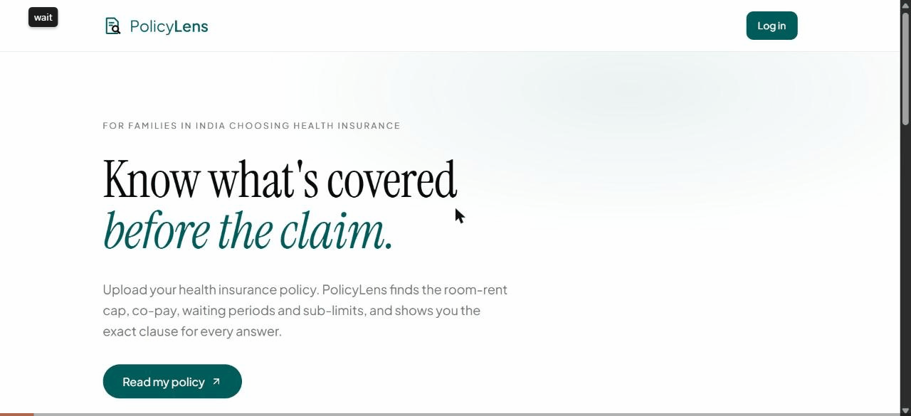

# PolicyLens

Know what your health insurance really covers, before the claim. Upload an Indian health-insurance policy PDF and get 20 plain-English answers (room-rent cap, co-pay, waiting periods, sub-limits, consumables and more), **each quoting the exact clause and page, checked against the PDF itself.**

**Live:** https://policylens-mocha.vercel.app (sign in with Google)



▶ [Watch the demo as video (MP4)](docs/demo.mp4)

**What a chatbot can't do for you:**

- **Claim calculator.** Enter a hospital bill and see what the policy pays, to the rupee. It applies the room-rent limit, proportionate deduction, ICU cap, consumables, cataract sub-limit, deductible and co-pay, with each cut linked to its clause. It's fixed rules in code (`lib/claim-calc.ts`), not AI, so the same bill always gives the same answer. A rule whose clause isn't verified is skipped and flagged, never guessed. It also suggests the room that avoids the cuts ("choose up to ₹5,000/day and pay ₹12,500 instead of ₹49,438").
- **"Am I covered yet?"** Enter your cover start date and any porting credit. You get the exact date each waiting period ends, one row per condition list, plus a search box ("knee replacement → covered from 15 Apr 2028") and a calendar (.ics) download.
- **Every quote checked against the PDF**, with a clause view that highlights it on the page.
- **Printable one-page policy card** for the family or the hospital desk, built only from verified clauses, with page numbers.
- **Side-by-side comparison** of 2–3 policies, and questions answered only from your policy.

## How it works

1. The PDF is read page by page (`unpdf`). Scanned, image-only PDFs are detected and refused.
2. Gemini returns structured JSON: 20 findings, each with a status, a summary, a **quote** and a **page**, plus typed facts for the rules.
3. **Every quote is checked in code** (`lib/citations.ts`) against the page text, after evening out the ways PDFs mangle text: line breaks, hyphenation, curly quotes, "Rs." vs "₹".
   - Exact match on the cited page: **verified**.
   - Found on a neighbouring page: **verified, page corrected**.
   - Found elsewhere: **verified, moved**.
   - Near-verbatim: **fuzzy** (≥90% of words in order, near the cited page only).
   - A quote shortened with "...": accepted only as **near-verbatim**, when every piece is word for word, in order and close together.
   - Otherwise: **not found**, never shown as fact.
   A quote with a changed number ("36 months" → "24 months") is rejected.
4. **Claim-risk warnings** are plain, tested rules over the facts. A warning only appears if the clause behind it was verified.
5. **Questions** get the same treatment: the AI answers from the document only, says when the policy doesn't say, and an answer whose quotes aren't found is shown struck through, not as fact.

## Results so far

| Check (`npm run eval`, live Gemini, free tier) | Facts right | Quotes verified | Questions right |
|---|---|---|---|
| Fictional 7-page sample policy | 13/13 | 20/20 | – |
| Real policy: Go Digit Arogya Sanjeevani, 25 pages (3 runs) | 13/13, 13/13, 19/19 incl. 6 calculator/timeline facts | 16/17, 18/18, 16/17 | 3/3, 3/3, 3/3 (incl. "the policy doesn't say" for premium) |

On the example bill, the calculator gives the same payout (₹1,08,062) from the AI's facts as from the hand labels.

That's 1 real policy so far, not 20: a small check, not a benchmark. Hand labels and their page references are in `tests/evals/real-policy-labels.ts`; the insurers' PDFs aren't in the repo, so put them in `eval-policies/` (the source URL is in the labels). Adding a policy is one entry there.

What the real policy taught us: the AI shortened long clauses with "...", which the checker rightly rejected. Now the prompt forbids it, and shortened quotes are checked piece by piece.

## Engineering

- Every query is filtered by the signed-in user's id. Tests show one user can't list, read, download, analyse or delete another's policy.
- Rate limits on uploads and AI analyses, stored in Postgres with hashed keys.
- The same file uploaded twice is stored once (unique `(userId, sha256)` index).
- Copied from CreatorDesk: security headers and CSP, a Gemini client with retries and fallback, short sessions.
- Uploads are capped at 4 MB because Vercel limits a request to 4.5 MB.

**Stack:** Next.js 16, React 19, TypeScript, Tailwind 4, shadcn/ui, Prisma 7 + PostgreSQL, Auth.js v5, Gemini (`@google/genai`), unpdf, Vitest.

## Run locally

```bash
cp .env.example .env    # DATABASE_URL, TEST_DATABASE_URL, AUTH_SECRET, GEMINI_API_KEY
npm install
npm run db:migrate && npm run db:test:migrate
npm run dev             # use "Dev sign in", then "Try a sample policy"
npm test                # unit + integration
npm run eval            # live AI check on the sample policy
```

PolicyLens explains what a policy document says. It isn't insurance advice and doesn't recommend or sell policies.
